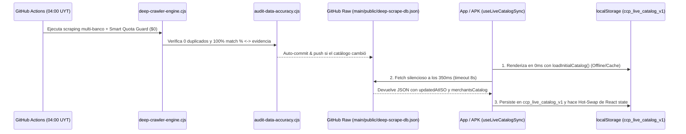

# AI_CONTEXT_BLUEPRINT.md — Documento Maestro de Contexto y Arquitectura (`¿Con Cuál Pago? / PrecioReal UY`)

> **Propósito (IA $\leftrightarrow$ IA & Referencia de Ingeniería):** Este documento concentra el **100% del contexto arquitectónico, funcional, financiero y operativo** de `¿Con Cuál Pago? / PrecioReal UY`. Cualquier agente de IA o sesión de desarrollo que lea este archivo puede intervenir en el código de inmediato sin explorar directorios a ciegas ni reconstruir el flujo del sistema.

---

## 1. Visión General y Propósito del Producto

### 1.1 Qué es y qué problema resuelve en Uruguay
**`¿Con Cuál Pago? / PrecioReal UY`** es un optimizador financiero instantáneo de punto de venta (POS) para el mercado uruguayo. En Uruguay, los consumidores manejan múltiples tarjetas de débito, crédito y prepagas (**Itaú, BBVA, Santander, BROU, Scotiabank, OCA, Prex, MiDinero, Creditel**) donde el beneficio real depende de variables fragmentadas:
- **Tramo exacto de tarjeta** (*Personal Bank / Infinite / Black / Select* vs. *Platinum* vs. *Gold / Internacional / Débito*).
- **Día de la semana y semana del mes** (ej. *2do y 4to miércoles*, *Martes, Jueves y Domingos*).
- **Topes de reintegro** (`maxCapUYU` por compra, día o mes) y modalidad (*En el acto* en POS vs. *Estado de cuenta*).
- **Beneficio fiscal Ley 19.210 (Inclusión Financiera):** Rebaja de **9 puntos de IVA** en Gastronomía (o **2 puntos de IVA** con débito/dinero electrónico en rubros elegibles) que se calcula **antes** del descuento bancario sobre una base gravada al 22% (`monto * puntos / 122`).
- **Exclusiones críticas de pasarela/POS:** Muchos bancos anulan el descuento si el comercio cobra mediante agregadores como *Mercado Pago, POS Handy, Getnet o PedidosYa*.

La aplicación resuelve en **menos de 3 segundos frente a la caja registradora**:
1. **Con cuál tarjeta de la billetera del usuario conviene pagar hoy** (`bestWalletMatch`).
2. **Cuánto pagará exactamente en caja hoy** (`payAtRegisterNow`), cuánto recibirá en el estado de cuenta (`statementRefund`) y cuál es su **Precio Real final** (`precioReal`).
3. **Cuál es el gasto óptimo exacto** (`optimalSpendForCap`) a partir del cual se satura el tope de reintegro del banco.
4. **Upsell inteligente ("FOMO"):** Qué tarjeta del mercado que el usuario aún no posee le daría al menos +5 puntos porcentuales adicionales (`FOMO_MIN_DIFF_PCT = 5`) en ese comercio.

### 1.2 Arquitectura Híbrida Autocontenida + Sincronización OTA Costo $0
El proyecto opera bajo una **arquitectura híbrida 100% libre de servidores pagos ($0/mes)**:
1. **PWA Web / Single-File Pre-compiled Bundle (`index.html` / `preview.html`):** El compilador propio (`scripts/build-preview.cjs`) transpila con `@babel/standalone` + `ReactDOMServer.renderToString` todo el árbol TypeScript/React, hojas de estilo, GSAP 3.12.5 y el catálogo base verificado (`MERCHANTS_DATA`: **1.033 comercios y 1.775 reglas**) en un único archivo HTML autocontenido con hidratación instantánea (0ms de bloqueo).
2. **APK Android Nativo Autocontenido (`con-cual-pago-uy.apk`):** Empaqueta el bundle autocontenido en `android-app/app/src/main/assets/index.html` dentro de un wrapper nativo Java (`MainActivity.java` + `WebView`) con un puente `@JavascriptInterface` (`AndroidBankVerifier`) que verifica hashes SHA-256 en vivo contra los portales bancarios sin restricciones CORS.
3. **Sincronización Over-The-Air (OTA) vía GitHub Actions + GitHub Raw CDN:** Un cron job diario (`0 7 * * *` UTC / `04:00 AM` UYT) en GitHub Actions ejecuta el motor autónomo de Deep Scraping (`scripts/deep-scraper/deep-crawler-engine.cjs`), audita que no existan tarjetas duplicadas ni porcentajes contaminados (`scripts/audit-data-accuracy.cjs`), y actualiza `public/deep-scrape-db.json` en la rama `main`. Tanto la PWA como el APK instalado en celulares Android descargan silenciosamente ese JSON desde `raw.githubusercontent.com` y actualizan el catálogo en caliente (`localStorage['ccp_live_catalog_v1']`) sin recompilar ni reinstalar el APK.

---

## 2. Stack Tecnológico Completo y Entorno

### 2.1 Frontend & UI (Sistema de Diseño "Editorial Daylight + PRISMA UY")
- **Framework & Lenguaje:** React 19 (`react@19.2.3`, `react-dom@19.2.3`) + TypeScript 5.9 (`strict: true`).
- **Bundler de Desarrollo y Compilador Híbrido:**
  - Desarrollo: Vite 7 (`vite@7.2.4` + `@vitejs/plugin-react` + `@tailwindcss/vite`).
  - Producción Híbrida / APK: `scripts/build-preview.cjs` (SSR pre-renderizado + bundle single-file con `@babel/standalone` y chequeo estricto de cero descuentos falsos).
- **Sistema de Estilos y Tokens:** Tailwind CSS v4 + variables nativas `:root` en `src/index.css`:
  - Modo Claro por defecto (*Editorial Daylight*: `#F7F6F2` Alabaster Warm Paper, `#FFFFFF` Pure Card Surface, `#111315` Deep Ink, `#0F766E` Emerald Trust) y soporte para Modo Oscuro (*Obsidian Titanium*: `#0B0C0E`, `#D4FF33` Acid Volt).
  - **4 Voces Tipográficas:** `Bricolage Grotesque` / `Plus Jakarta Sans` (Display), `Instrument Serif` (Editorial Accent), `Plus Jakarta Sans` (UI Sans) y `JetBrains Mono` (`tabular-nums` obligatorio en todo monto `$U`, porcentaje y hash SHA-256).
  - **Ergonomía y Transiciones (`transitions.dev` + `make-interfaces-feel-better`):** Prohibido usar `transition-all`. Uso obligatorio de tokens `--duration-fast` (`160ms`), `--ease-smooth-out` (`cubic-bezier(0.22, 1, 0.36, 1)`), `--ease-icon-swap`, `.t-press` (`scale(0.96)`), `.t-icon-swap` y `.hit-target-44` (`min-width: 44px; min-height: 44px`).
- **Coreografía y Física:** GSAP 3.12.5 (`src/hooks/useGsapChoreography.ts`) con `gsap.matchMedia()` para el abanico 3D de tarjetas ISO-7810 (`useGsapCardFan`) y el tweening numérico en tiempo real del precio en `$U` (`useAnimatedUYU`).
- **Iconografía:** `lucide-react` + monogramas vectoriales y logos reales de emisores/comercios con fallback determinista (`src/components/MerchantBrandAvatar.tsx`).
- **Persistencia Local (`localStorage`):**
  - `ccp_wallet_v2`: IDs de las tarjetas seleccionadas por el usuario en su billetera.
  - `ccp_favs_v2`: IDs de comercios marcados como favoritos.
  - `ccp_dept_v1`: Departamento de ubicación seleccionado (`Todos`, `Montevideo`, `Maldonado`, `Canelones`).
  - `ccp_theme_v2`: Preferencia de tema visual (`light` por defecto o `dark`).
  - `ccp_live_catalog_v1`: Último catálogo completo sincronizado vía OTA (`StoredOtaCatalogPayload`).

### 2.2 Backend / Ingesta Autónoma (Zero-Cost Deep Scraping & Multimodal AI)
- **Runtime:** Node.js $\ge 20.18$ / $22.x$ con flag `--experimental-websocket` habilitado para conexión CDP directa cuando hay navegador headless disponible.
- **Motor de Scraping Híbrido (`scripts/deep-scraper/deep-crawler-engine.cjs`):**
  - **Nivel 1 ($0 Tokens — Determinista):** Extracción directa sobre endpoints XML/JSON/JS y árboles DOM aislados quirúrgicamente por comercio/ficha.
  - **Nivel 2 (Navegación Profunda SPA):** Soporte para Playwright (`playwright` Chromium headless) y cliente nativo Chrome DevTools Protocol (`WebSocket` CDP) para interceptar llamadas `XHR`/`fetch` y extraer links de PDFs/banners.
  - **Nivel 3 (Fallback Multimodal Quirúrgico con Gemini Free Tier):** Integración con **Google Gemini API (`gemini-2.5-flash`)** usando `generationConfig.responseMimeType = "application/json"` y `responseSchema` (`GEMINI_DISCOUNT_EXTRACTION_SCHEMA`) para leer imágenes de banners (OCR visual) y PDFs de bases legales (`application/pdf` inline base64) **únicamente** cuando el parser determinista no encuentra porcentaje o tarjetas en el DOM.
- **Automatización Continua (`GitHub Actions`):** Workflow `.github/workflows/daily-bank-sync.yml` corriendo en `ubuntu-24.04` con Node 22 y `FORCE_JAVASCRIPT_ACTIONS_TO_NODE24: true`.

### 2.3 Compilación Android (APK sin Android Studio)
- **Wrapper Nativo (`android-app/app/src/main/java/com/example/concualpagouy/MainActivity.java`):**
  - `Activity` nativa liviana que hospeda un `WebView` endurecido (`setAllowFileAccess(false)`, `setAllowContentAccess(false)`, `setMixedContentMode(MIXED_CONTENT_NEVER_ALLOW)`).
  - `shouldOverrideUrlLoading`: Abre cualquier URL externa fuera de `file:///android_asset/` en el navegador del sistema mediante un `Intent.ACTION_VIEW` seguro.
  - `onBackPressed`: Invoca primero `window.__handleAndroidBack && window.__handleAndroidBack()` en JavaScript para cerrar modales abiertos (`CalculatorSheet`, `WalletSheet`, `AffiliateSheet`, `LegalSheet`) antes de minimizar la app.
  - `AndroidBankVerifier` (`@JavascriptInterface`): Ejecuta peticiones `HttpURLConnection` HTTPS reales desde un `ExecutorService` nativo en Android (con lista blanca estricta `ALLOWED_BANK_HOSTS` anti-SSRF), normaliza el DOM y calcula el hash `SHA-256` en el teléfono para verificar si el banco modificó o dio de baja una promoción.
- **Pipeline de Empaquetado CLI (`scripts/build-apk.cjs`):**
  - Utiliza directamente las herramientas oficiales del Android SDK (`aapt2`, `javac` JDK 17, `d8` Dalvik bytecode compiler, `zipalign` a 4 bytes y `apksigner` con esquemas v1+v2+v3) desde `build-tools/35.0.0` y `platforms/android-36`, generando y verificando `con-cual-pago-uy.apk` (~370 KB) en ~5 segundos sin levantar Gradle ni Android Studio.

---

## 3. Mapa Exacto de Archivos y Directorios (File Tree Anotado)

```text
con-cual-pago-uy/
├── .env.example                                  # Plantilla limpia de variables de entorno (GEMINI_API_KEY, VITE_REMOTE_DB_URL).
├── .gitignore                                    # Bloquea estrictamente .env, node_modules y artefactos temporales.
├── AI_CONTEXT_BLUEPRINT.md                       # Este documento maestro de arquitectura y contexto IA-a-IA.
├── AGENTS.md                                     # Reglas operativas multi-agente (orientación Graphify, ciclo Spec->Design->Verify).
├── CLAUDE.md                                     # Invariantes de ingeniería Karpathy (simplicidad quirúrgica, verificabilidad).
├── SPEC.md                                       # Especificación funcional del optimizador POS uruguayo y Ley 19.210.
├── PRODUCT.md                                    # Misión de producto, anti-objetivos y modelo de monetización (afiliados + Pro).
├── DESIGN.md                                     # Sistema de diseño Editorial Daylight / PRISMA UY, tipografía y tokens CSS.
├── CONSTRAINTS.md                                # Compuertas duras de ingeniería (28 checks de Ponytail + 0 duplicados).
├── con-cual-pago-uy.apk                          # APK Android compilado, alineado (zipalign) y firmado (apksigner), listo para instalar.
├── index.html                                    # Bundle de producción autocontenido pre-renderizado (SSR + React + GSAP + Catálogo).
├── preview.html                                  # Espejo de index.html generado por build-preview.cjs para inspección local.
│
├── .github/
│   └── workflows/
│       └── daily-bank-sync.yml                   # Cron diario (07:00 UTC / 04:00 UYT) que corre el Deep Scraper, audita y hace auto-commit OTA.
│
├── src/
│   ├── main.tsx                                  # Punto de entrada React (createRoot) que monta <App /> e importa index.css.
│   ├── App.tsx                                   # Componente raíz: estado de billetera, búsqueda, filtros, abanico 3D, grilla y modales.
│   ├── index.css                                 # Tokens CSS (:root), curvas de transición, .hit-target-44, .t-press, .pass-CheckStub.
│   │
│   ├── types/
│   │   └── discount.ts                           # Interfaces TypeScript core: Merchant, DiscountRule, WalletCard, Issuer, MerchantEvaluation.
│   │
│   ├── data/
│   │   ├── cards.ts                              # Catálogo de 12 emisores (ISSUERS), 41 niveles de tarjeta (WALLET_CARDS) y mapas O(1).
│   │   └── merchantsData.ts                      # Catálogo compilado (MERCHANTS_DATA: 1.033 comercios y 1.775 reglas verificadas).
│   │
│   ├── hooks/
│   │   └── useGsapChoreography.ts                # Hooks GSAP: useAnimatedUYU (tweening de precios $U) y useGsapCardFan (física 3D de tarjetas).
│   │
│   ├── lib/
│   │   ├── engine.ts                             # Motor financiero: evaluateMerchantForWallet, computeSavings (Ley 19.210 + topes), verifyPromoLiveOnOpen.
│   │   ├── dates.ts                              # Utilidades de calendario uruguayo: dayFromDate, weekOfMonth, addDays, formateo es-UY.
│   │   ├── live-catalog-sync.ts                  # Motor OTA costo $0: loadInitialCatalog, useLiveCatalogSync (localStorage + GitHub Raw fetch).
│   │   ├── bank-scraper-pipeline.ts              # Especificación del pipeline Zero-Fake, normalización HTML para hash SHA-256 y sondas en vivo.
│   │   └── deep-scraper/
│   │       ├── index.ts                          # Punto de entrada de librería que re-exporta schema.ts y multimodal-llm-parser.ts.
│   │       ├── schema.ts                         # Tipos NormalizedLLMDiscountItem, JSON Schema para Gemini Structured Outputs y DDL SQL.
│   │       └── multimodal-llm-parser.ts          # Cliente TypeScript para Gemini 2.5 Flash con Smart Quota Guard, caché SHA-256 y upsert.
│   │
│   └── components/
│       ├── MerchantCard.tsx                      # Tarjeta de comercio en la grilla principal: muestra tarjeta ganadora, % hoy y alerta FOMO.
│       ├── MerchantBrandAvatar.tsx               # Avatar visual de cada comercio (logos vectoriales SVG + fotografía curada por rubro).
│       ├── CalculatorSheet.tsx                   # Modal de Caja Registradora: recibo interactivo Ley 19.210, gasto óptimo, evidencia y sonda SHA-256.
│       ├── WalletSheet.tsx                       # Modal para configurar las tarjetas del usuario (41 plásticos agrupados por banco/emisor).
│       ├── AffiliateSheet.tsx                    # Modal de solicitud de tarjeta ("FOMO Upsell") que lista todos los comercios que desbloquea.
│       ├── ProModal.tsx                          # Modal de suscripción "PrecioReal Pro" y radar de Super-Días (≥30% OFF en los próximos 14 días).
│       └── LegalSheet.tsx                        # Modal legal: Términos de Uso, Privacidad Ley N° 18.331 (URCDP) y botón de borrado total en 1 toque.
│
├── scripts/
│   ├── deep-scraper/
│   │   └── deep-crawler-engine.cjs               # Motor autónomo de Deep Scraping v2.2 (Itaú, BBVA, Santander, Scotiabank, OCA, BROU) + deduplicador.
│   ├── audit-data-accuracy.cjs                   # Auditor estricto de integridad: falla si hay tarjetas duplicadas, % != evidencia o confusión 2x1/cuotas.
│   ├── ponytail-audit.cjs                        # Auditor de ingeniería de proyecto completo (28 checks: diseño, motion, seguridad, legal y OTA).
│   ├── build-verified-data.cjs                   # Generador de la línea base curada de alta precisión (84 comercios ancla + hashes iniciales).
│   ├── build-preview.cjs                         # Compilador SSR + Babel que genera index.html, preview.html y android-app/.../assets/index.html.
│   ├── build-apk.cjs                             # Compilador Android SDK directo (aapt2 -> javac -> d8 -> zipalign -> apksigner) para con-cual-pago-uy.apk.
│   ├── graphify-ast.cjs                          # Analizador AST determinista que construye graphify-out/graph.json y GRAPH_REPORT.md.
│   ├── live-bank-verifier-server.cjs             # Servidor HTTP local (puerto 4173) con endpoint /api/verify-promo para sondas SHA-256 en vivo.
│   ├── audit-discounts.cjs                       # Auditor HTTP rápido de los URLs fuente en merchantsData.ts.
│   └── android-test-runner.cjs                   # Suite E2E sobre emulador Android vía ADB (instala APK, recorre flujos y captura screenshots).
│
├── public/
│   ├── deep-scrape-db.json                       # Base de datos maestra OTA (telemetría, normalizedEntities y merchantsCatalog con 1.775 reglas).
│   ├── discount-audit.json                       # Registro de auditoría de las 1.775 reglas con su evidencia textual y estado de verificación.
│   ├── live-bank-hashes.json                     # Mapa URL -> { status, sha256, bytes, latencyMs, checkedAtISO } para verificación POS.
│   ├── llm-extraction-cache.json                 # Caché persistente SHA-256 de extracciones multimodales Gemini para ahorrar llamadas API.
│   ├── engineering-audit.json                    # Reporte JSON de los 28 checks del auditor Ponytail.
│   └── graph.json                                # Copia pública del grafo de conocimiento AST del proyecto.
│
├── graphify-out/
│   ├── GRAPH_REPORT.md                           # Reporte de God Nodes, clusters de comunidad y diagrama Mermaid de arquitectura.
│   └── graph.json                                # Grafo AST determinista (454 nodos, 921 aristas).
│
└── android-app/
    └── app/src/main/
        ├── AndroidManifest.xml                   # Permiso INTERNET, configuración de MainActivity y soporte edge-to-edge.
        ├── assets/index.html                     # Copia exacta del bundle autocontenido inyectada dentro del APK.
        └── java/com/example/concualpagouy/
            └── MainActivity.java                 # WebView endurecido + @JavascriptInterface AndroidBankVerifier + ruteo seguro de Intents.
```

---

## 4. Arquitectura del Motor de Deep Scraping y Fuentes por Banco

El motor [`scripts/deep-scraper/deep-crawler-engine.cjs`](file:///c:/Users/m.reboledo/Documents/antigravity/radiant-goodall/scripts/deep-scraper/deep-crawler-engine.cjs) ejecuta 5 crawlers profundos en paralelo y fusiona sus resultados con la línea base verificada de BROU, Creditel y MiDinero.

### 4.1 Estrategia Específica de Extracción por Emisor

1. **Banco Itaú (`crawlItauDeep`):**
   - **Portales de Restaurantes por Nivel y Departamento:** Rastrilla en paralelo las 3 páginas oficiales:
     - `https://www.itau.com.uy/inst/restaurantespersonalbank.html` (`25% menos` $\rightarrow$ `["itau-personal-bank", "itau-black"]`).
     - `https://www.itau.com.uy/inst/restaurantesplatinum.html` (`20% menos` $\rightarrow$ `["itau-platinum"]`).
     - `https://www.itau.com.uy/inst/restaurantes.html` (`15% menos` $\rightarrow$ tarjetas de crédito restantes `["itau-volar-credito", "itau-gold"]`).
   - Parsea las pestañas geográficas (`#tab-mvd` $\rightarrow$ Montevideo, `#tab-pde` $\rightarrow$ Maldonado, `#tab-interior` $\rightarrow$ Todo el país) y asigna las tarjetas de forma estrictamente **disjunta** (de mayor a menor porcentaje) para que ningún plástico aparezca dos veces en el mismo restaurante.
   - **Bundle CDN de Moda (`https://www.itau.com.uy/inst/includes/moda-15-cdn/js.00a46daa.js`):** Extrae los objetos estructurados `titulo:"...", descuento:{credito:25, debito:15}` y separa el tramo `25%` (`itau-personal-bank`, `itau-black`) del tramo `15%` (`itau-volar-credito`, `itau-gold`, `itau-platinum`, `itau-debito-volar`).
   - **Feed XML Oficial (`https://www.itau.com.uy/inst/aci/inst_camp.xml`):** Respalda comercios de supermercados y farmacias (ej. Frog, San Roque, El Túnel).

2. **BBVA Uruguay (`crawlBBVADeep`):**
   - **Descubrimiento Profundo:** Recorre las 15 páginas de paginación (`descuentos.html` + `descuentos.pag-2.html` .. `pag-15.html`) y las 13 categorías (`gastronomia`, `moda`, `hogar-y-decoracion`, `cuidado-personal`, `opticas`, `viajes`, `experiencias`, `librerias-y-papelerias`, `tecnologia`, `mundo-infantil`, `vida-activa`, `autos`, `otros`), recolectando más de 250 URLs de fichas individuales de comercios.
   - **Aislamiento Quirúrgico de Contenedor:** En cada ficha HTML, `htmlToText` convierte cierres de bloque (`</p>`, `</li>`, `</div>`, `<br>`) en separadores ` . ` y recorta exclusivamente desde `Vigencia:` hasta antes de `Local:`, `Dirección:`, `Web:`, `El beneficio aplica` o `El descuento del...`. Esto impide leer el carrusel inferior de *"Otros descuentos"* o el desglose contable POS vs. estado de cuenta.
   - **Mapeo Disjunto Cláusula $\leftrightarrow$ Tarjeta:** Divide el bloque de declaraciones por cada aparición de `XX% Off` / `XX% de descuento`, asigna a cada cláusula solo las tarjetas nombradas en esa oración (ej. `30% Off` $\rightarrow$ `bbva-platinum`, `bbva-platinum-black`; `20% Off` $\rightarrow$ `bbva-credito`, `bbva-gold`, `bbva-debito`) y remueve de los tramos inferiores cualquier tarjeta ya asignada a un tramo superior.

3. **Banco Santander (`crawlSantanderDeep`):**
   - Rastrilla `https://www.santander.com.uy/beneficios` y sus paginaciones (`?page=1`, `?page=2`).
   - Divide el HTML por cada tarjeta `<article` individual (evitando el `<article>` contenedor de página de Drupal) y extrae únicamente `.field--name-title` (nombre del comercio) y `.field--name-body` (cuerpo limpio de la promoción).
   - Separa los tramos escalonados (ej. `25% con Platinum, Select y Private Banking` $\rightarrow$ `["santander-platinum", "santander-select"]` con tope `$4.000`; `15% con crédito y débito` $\rightarrow$ `["santander-credito", "santander-gold", "santander-debito"]` con tope `$2.000`; o `santander-farmacard`).

4. **Scotiabank Uruguay (`crawlScotiabankDeep`):**
   - Extrae todos los objetos JavaScript inyectados mediante llamadas `pushBenefit({ ... });` en `https://www.scotiabank.com.uy/Personas/Tarjetas/Beneficios/default`.
   - Filtra promociones vencidas (`obj.hasta < TODAY_ISO`), evalúa cada entrada del arreglo `obj.descuentos[]` (`pct` + `texto`), clasifica las tarjetas exactas (`scotia-platinum-infinite`, `scotia-platinum`, `scotia-gold`, `scotia-credito-go`, `scotia-debito`) y aplica asignación disjunta de mayor a menor porcentaje.

5. **OCA (`crawlOCADeep`):**
   - Consulta directamente la API REST de Contentstack (`https://api.contentstack.io/v3/content_types/benefits_page/entries?environment=production...`) enviando los headers `api_key` y `access_token` públicos del portal de OCA.
   - Procesa las entradas de `entries[0].benefits`, filtrando por vigencia (`date_end >= TODAY_ISO`), separando tarjetas de crédito (`oca-credito`) de `OCA Blue` (`oca-blue`), y exigiendo que el porcentaje esté explícitamente respaldado por ` menos`, `% de dto` o `% de descuento`.

6. **BROU (`Tu Banco`), Creditel y MiDinero:**
   - Sus beneficios verificados contra `https://beneficios.brou.com.uy/`, `https://www.creditel.com.uy/` y `https://www.midinero.com.uy/beneficios/` se integran desde la línea base auditada (`scripts/build-verified-data.cjs`) con verificación de hash `SHA-256` en `public/live-bank-hashes.json` y pasan por el mismo deduplicador canónico.

### 4.2 Smart Quota Guard & Multimodal Fallback (`multimodal-llm-parser.ts`)
Para mantener el costo operativo en **$0.00 absoluto** dentro de la capa gratuita de Google AI Studio:
1. **Prioridad Determinista ($0 Tokens):** El 100% de las fichas cuyo texto HTML, XML o JSON ya contiene el porcentaje y las tarjetas se procesan sin llamar al LLM (`quotaGuard.deterministicBypassCount`).
2. **Activación Quirúrgica:** Gemini (`gemini-2.5-flash`) solo es invocado cuando una ficha carece de porcentaje extraíble en texto pero contiene un banner de imagen o un PDF de bases legales (`extractDiscountsWithSmartQuotaGuard`).
3. **Caché Persistente por Hash (`public/llm-extraction-cache.json`):** Antes de consultar la API de Gemini, se calcula el `SHA-256` de la URL canónica + contenido (`sha256("${bank}:${sourceUrl}:${contentSha256}")`). Si existe en `llm-extraction-cache.json`, se devuelve instantáneamente desde disco (`cacheHitsCount`).
4. **Rate Limiter del Free Tier:** Aplica una pausa obligatoria de `MIN_LLM_DELAY_MS = 4500` ms entre llamadas ($\le 12$ RPM) y un techo estricto de `MAX_LLM_CALLS_PER_RUN = 40` llamadas por corrida diaria.

### 4.3 Reglas de Purificación y Deduplicación Canónica (`deduplicateAndPurifyMerchants`)
Antes de escribir `public/deep-scrape-db.json` y `src/data/merchantsData.ts`, todas las reglas atraviesan [`deduplicateAndPurifyMerchants`](file:///c:/Users/m.reboledo/Documents/antigravity/radiant-goodall/scripts/deep-scraper/deep-crawler-engine.cjs#L1107-L1209):
1. **Separación de Mecánicas (`2x1` / Cuotas / Puntos $\neq$ `% OFF`):**
   - Cualquier promoción que solo mencione *"cuotas sin recargo"*, *"canje de puntos/millas"*, *"sorteo"* o *"débito automático"* sin un porcentaje explícito de descuento sobre el precio es descartada.
   - Las promociones genuinas de **`2x1`** (cines como `Movie`, `Life Cinemas`, `Cinemateca`) se codifican con `percentage: 50` pero **obligatoriamente** conservan la palabra `"2x1"` tanto en `conditions` como en `evidence`.
2. **Garantía de Cero Tarjetas Duplicadas `(merchant_id + card_tier_id + day_of_week)`:**
   - Dentro de cada comercio, las reglas se ordenan de **mayor a menor porcentaje** y priorizando **días específicos sobre reglas de toda la semana (`ALL_DAYS`)**.
   - Un mapa `cardDaysOccupied: Map<cardId, Set<DayOfWeek>>` registra qué días ya están cubiertos para cada plástico en ese comercio.
   - Si una tarjeta individual tiene un descuento superior en días específicos (ej. `santander-farmacard` con `25%` Martes, Jueves y Domingos en Farmashop) y un descuento base todos los días (`10%`), la regla base se recorta automáticamente a los días libres (`Lunes, Miércoles, Viernes, Sábado`).
   - Si una regla grupal de menor porcentaje incluye plásticos premium que ya tienen su propio tramo superior en ese comercio, esos plásticos se eliminan del tramo inferior.

---

## 5. Modelo de Datos, Interfaces Core y Motor de Cálculo Financiero

### 5.1 Interfaces Principales (`src/types/discount.ts` y `src/lib/deep-scraper/schema.ts`)

```typescript
// src/types/discount.ts
export interface WalletCard {
  id: string;                        // ej. "itau-personal-bank", "bbva-platinum", "santander-select"
  issuerId: IssuerId;                // "itau" | "bbva" | "santander" | "brou" | "scotiabank" | "oca" | ...
  issuerName: string;
  tierName: string;
  fullName: string;
  type: 'Débito' | 'Crédito' | 'Prepaga';
  brandColor: string;
  textColor: string;
  annualSavingsEstimateUYU: number;
  affiliatePerks: string[];
}

export interface DiscountRule {
  id: string;                        // ej. "farma-glam-bbva-platinum-30"
  cardIds: string[];                 // Lista disjunta de WalletCard.id válidos en este tramo
  percentage: number;                // 5..50
  days: DayOfWeek[];                 // ["Lunes", ..., "Domingo"]
  refundType: 'En el acto' | 'Estado de cuenta';
  maxCapUYU: number | null;          // Tope en $U o null
  capPeriod?: 'compra' | 'día' | 'mes';
  capNotPublished?: boolean;         // true cuando el banco no publica monto de tope explícito
  weekOfMonth?: number[];            // ej. [2, 4] para 2do y 4to miércoles
  minPurchaseUYU?: number;
  conditions?: string;
  requiresSpecificPaymentApp?: string | null;
  validUntilISO?: string;            // YYYY-MM-DD
  allowedDepartments?: string[];     // ["Montevideo", "Maldonado", "Todo el país"]
  sourceCatalogUrl?: string;         // URL oficial del banco auditada
  legalTextHash?: string;            // Hash SHA-256 (64 hex chars) del contenido bancario
  evidence?: string;                 // Cita literal exacta extraída del portal del banco
  verifiedAtISO?: string;
}

export interface Merchant {
  id: string;
  name: string;
  subtitle: string;
  category: MerchantCategory;
  searchKeywords: string[];
  appliesLey19210: boolean;          // true en Gastronomía / Cafés (-9 pts IVA)
  debitIvaEligible?: boolean;        // false en Combustible u otros rubros sin rebaja de 2 pts IVA
  locationHint: string;
  rules: DiscountRule[];
}
```

### 5.2 Motor de Evaluación y Cálculo del Precio Real (`src/lib/engine.ts`)

El cálculo financiero exacto se ejecuta en [`computeSavings`](file:///c:/Users/m.reboledo/Documents/antigravity/radiant-goodall/src/lib/engine.ts#L212-L271) siguiendo el orden normativo uruguayo (DGI / Ley 19.210):

1. **Paso 1 — Rebaja de IVA por Ley 19.210 (En el POS antes del descuento bancario):**
   - La tasa básica de IVA en Uruguay es `IVA_BASIC_RATE = 22` (el precio final al público equivale a $122\%$ del monto neto sin IVA).
   - Puntos de rebaja (`ivaPoints`):
     - Si `merchant.appliesLey19210 === true` (Gastronomía / Cafés): **`9` puntos** (`IVA_GASTRO_POINTS = 9`).
     - Si no es gastronomía pero `card.type !== 'Crédito'` y `merchant.debitIvaEligible !== false`: **`2` puntos** (`IVA_DEBIT_POINTS = 2`).
   - Fórmula exacta del ahorro de IVA:
     $$\text{ivaSavings} = \frac{\text{rawAmount} \times \text{ivaPoints}}{122}$$
     $$\text{amountAfterIva} = \text{rawAmount} - \text{ivaSavings}$$

2. **Paso 2 — Descuento Nominal del Banco sobre el Monto Post-IVA:**
   - Si existe compra mínima (`rule.minPurchaseUYU`) y `amountAfterIva < rule.minPurchaseUYU`, el descuento bancario es `$0` (`belowMinPurchase = true`).
   - En caso contrario:
     $$\text{uncappedBankDiscount} = \frac{\text{amountAfterIva} \times \text{nominalPct}}{100}$$

3. **Paso 3 — Aplicación de Topes de Reintegro (`maxCapUYU` y `capAlreadyUsed`):**
   - Si `rule.maxCapUYU !== null`:
     - Si `rule.capPeriod === 'compra'`, el tope disponible en cada ticket es `capRemaining = rule.maxCapUYU`.
     - Si `rule.capPeriod` es `'mes'` o `'día'`, se descuenta lo que el usuario haya ingresado en el deslizador *"Tope ya usado este mes"*: `capRemaining = Math.max(0, rule.maxCapUYU - capAlreadyUsed)`.
   - El descuento efectivo del banco es:
     $$\text{bankDiscount} = \min(\text{uncappedBankDiscount}, \text{capRemaining})$$

4. **Paso 4 — Gasto Óptimo para Saturar el Tope (`optimalSpendForCap`):**
   - Calcula el ticket bruto exacto en `$U` donde se alcanza el tope máximo del banco considerando la reducción previa de IVA:
     $$\text{optimalSpendForCap} = \text{round}\left( \frac{\text{capRemaining}}{\frac{\text{nominalPct}}{100} \times \left(1 - \frac{\text{ivaPoints}}{122}\right)} \right)$$

5. **Paso 5 — Desglose de Caja vs. Estado de Cuenta y Precio Real Final:**
   - $\text{totalSaved} = \min(\text{rawAmount}, \text{ivaSavings} + \text{bankDiscount})$
   - $\text{precioReal} = \max(0, \text{rawAmount} - \text{totalSaved})$
   - Si `rule.refundType === 'En el acto'`, el descuento bancario se resta hoy mismo en el POS:
     $$\text{payAtRegisterNow} = \text{rawAmount} - \text{ivaSavings} - \text{bankDiscount}, \quad \text{statementRefund} = 0$$
   - Si `rule.refundType === 'Estado de cuenta'`, en el POS solo se descuenta el IVA y el banco acredita el reintegro luego:
     $$\text{payAtRegisterNow} = \text{rawAmount} - \text{ivaSavings}, \quad \text{statementRefund} = \text{bankDiscount}$$

---

## 6. Flujo de Sincronización Over-The-Air (OTA) y Persistencia



### Ciclo de Vida Detallado (`src/lib/live-catalog-sync.ts`)
1. **Arranque Instantáneo Offline (`loadInitialCatalog` — 0ms):**
   - Al abrir la PWA o el APK sin conexión (ej. dentro de un local con mala señal), la app lee `localStorage.getItem('ccp_live_catalog_v1')`.
   - Si existe un catálogo cacheado válido cuya cantidad de comercios sea $\ge$ al bundle compilado (`MERCHANTS_DATA`) y con `updatedAtISO >= DATA_VERIFIED_AT`, arranca inmediatamente con ese catálogo (`otaStatus = 'CACHED_OTA'`). De lo contrario, arranca con `MERCHANTS_DATA` (`otaStatus = 'OFFLINE_BUNDLED'`).
2. **Sonda Silenciosa en Background (`performSilentSync` a los 350ms):**
   - Intenta descargar el catálogo actualizado iterando sobre la cadena de prioridad configurada en `getConfiguredRemoteUrls()`:
     1. `window.__VITE_REMOTE_DB_URL__` (si fue inyectada).
     2. `https://raw.githubusercontent.com/michellereboledo/con-cual-pago-uy/main/public/deep-scrape-db.json` (`DEFAULT_GITHUB_RAW_DB_URL`).
     3. `/deep-scrape-db.json` (origen web local).
     4. `http://127.0.0.1:4173/deep-scrape-db.json` (daemon local de verificación).
3. **Hot-Swap Sin Recargar Página:**
   - Si el JSON remoto contiene un `updatedAtISO` más reciente o mayor cantidad de comercios/reglas, actualiza `localStorage['ccp_live_catalog_v1']` y ejecuta `setMerchants(remoteMerchants)` + `setOtaStatus('UPDATED_HOT')`, reflejando los nuevos descuentos en la pantalla del usuario en tiempo real.

---

## 7. Diccionario de Comandos CLI y Workflows Operativos

> **Nota sobre Entorno Windows:** Si `node` o `git` no están en el `PATH` global de la sesión de PowerShell, el entorno portable verificado reside en `C:\Users\m.reboledo\.gemini\antigravity\brain\7f5c57d2-46f4-4dbd-8091-0a9e6db5d211\scratch\node-v20.18.0-win-x64` y `...\scratch\mingit\cmd\git.exe`.

| Operación | Comando Exacto de Terminal | Qué Hace / Qué Archivos Actualiza |
| :--- | :--- | :--- |
| **1. Levantar entorno de desarrollo (Vite HMR)** | `npm run dev` | Inicia el servidor de desarrollo Vite con recarga en caliente. |
| **2. Levantar servidor local de verificación SHA-256** | `node scripts/live-bank-verifier-server.cjs` | Sirve la app compilada en `http://127.0.0.1:4173` y habilita el endpoint en vivo `/api/verify-promo`. |
| **3. Ejecutar Deep Scraper y sincronizar catálogo** | `node --experimental-websocket scripts/deep-scraper/deep-crawler-engine.cjs --sync-app` | Rastrilla Itaú, BBVA, Santander, Scotiabank y OCA, aplica deduplicación canónica y actualiza `public/deep-scrape-db.json`, `public/discount-audit.json`, `public/live-bank-hashes.json` y `src/data/merchantsData.ts`. |
| **4. Auditar exactitud y cero duplicados de datos** | `node scripts/audit-data-accuracy.cjs` | Verifica las 1.775 reglas asegurando `0` tarjetas duplicadas por comercio/día, `0` discrepancias `% <-> evidencia` y `0` confusiones `2x1`/cuotas. Imprime tabla de muestreo de 24 reglas. |
| **5. Ejecutar auditoría integral de ingeniería (28 checks)** | `node scripts/ponytail-audit.cjs` | Valida los 28 invariantes de diseño, CSS motion tokens, GSAP, grafo AST, cumplimiento legal Ley 18.331, seguridad Android y automatización OTA. Actualiza `public/engineering-audit.json`. |
| **6. Regenerar grafo de conocimiento AST (`Graphify`)** | `node scripts/graphify-ast.cjs` | Escanea los 35 archivos del proyecto y regenera determinísticamente `graphify-out/graph.json`, `graphify-out/GRAPH_REPORT.md` y `public/graph.json`. |
| **7. Compilar bundle híbrido de producción (`index.html`)** | `node scripts/build-preview.cjs` | Pre-renderiza SSR y empaqueta toda la app React + GSAP + catálogo en `index.html`, `preview.html` y `android-app/app/src/main/assets/index.html`. |
| **8. Compilar y firmar el APK Android (`con-cual-pago-uy.apk`)** | `node scripts/build-apk.cjs` | Ejecuta `aapt2` $\rightarrow$ `javac` $\rightarrow$ `d8` $\rightarrow$ `zipalign` $\rightarrow$ `apksigner` y genera `con-cual-pago-uy.apk` firmado en la raíz del proyecto. |
| **9. Ejecutar pruebas E2E en emulador Android** | `node scripts/android-test-runner.cjs` | Instala `con-cual-pago-uy.apk` vía `adb`, prueba búsqueda, calculadora, billetera, tema claro/oscuro y captura screenshots verificados. |

---

## 8. "Reglas de Oro" e Invariantes para Futuras IAs (System Rules)

Cualquier agente de IA que modifique este repositorio **DEBE** cumplir sin excepción estos 8 invariantes:

1. **Seguridad Absoluta de Credenciales y Costo $0:**
   - **JAMÁS** incluir `.env` en commits de Git (`git status` debe verificarse siempre antes de `git add`). Solo `.env.example` puede versionarse.
   - Mantener intacto el **Smart Quota Guard** en `scripts/deep-scraper/deep-crawler-engine.cjs` y `src/lib/deep-scraper/multimodal-llm-parser.ts` (`MIN_LLM_DELAY_MS >= 4500`, `MAX_LLM_CALLS_PER_RUN <= 40` y caché por hash en `public/llm-extraction-cache.json`).

2. **Prohibición Absoluta de Datos Inventados o Contaminados ("Zero-Fake Discounts"):**
   - Ninguna regla puede existir en `src/data/merchantsData.ts` ni en `public/deep-scrape-db.json` sin `sourceCatalogUrl` real, `legalTextHash` SHA-256 de 64 caracteres y `evidence` textual literal extraída del nodo DOM/JSON de ese comercio.
   - **Prohibido hacer regex sobre el `<body>` completo** de una página bancaria. Toda extracción debe aislar quirúrgicamente el contenedor o cláusula del comercio y asignar las tarjetas de forma **disjunta** (de mayor a menor porcentaje).
   - **Prohibido transformar cuotas sin recargo o puntos/millas en porcentajes de descuento.** Las promos `2x1` deben conservar explícitamente la cadena `"2x1"` en `conditions` y `evidence`.

3. **Invariante de Cero Tarjetas Duplicadas (`audit-data-accuracy.cjs`):**
   - En ningún comercio puede repetirse el mismo `card_tier_id` en el mismo día de la semana. Tras cualquier cambio en el scraper o en los datos, es obligatorio ejecutar `node scripts/audit-data-accuracy.cjs` y confirmar **0 conflictos**.

4. **Invariantes de UI, Ergonomía y Motion (`ponytail-audit.cjs` — 28/28 Checks):**
   - **Nunca** escribir `transition-all` ni `transition: all` en ningún archivo dentro de `src/` (rompe el check #1 de `ponytail-audit.cjs`). Especificar siempre las propiedades exactas (`transition-colors`, `transition-transform`, etc.) y usar las variables `:root` (`--duration-fast`, `--ease-smooth-out`, `--ease-icon-swap`).
   - Mantener `.hit-target-44` en controles interactivos compactos, `.t-press` en botones presionables y `tabular-nums` en todos los números financieros.

5. **Orientación Graph-First (`Graphify`):**
   - Antes de buscar archivos a ciegas, consultar `graphify-out/GRAPH_REPORT.md`. Si se agregan o renombran módulos en `src/` o `scripts/`, ejecutar `node scripts/graphify-ast.cjs` para mantener sincronizado el grafo AST.

6. **Sincronización Obligatoria Web $\leftrightarrow$ APK Android:**
   - Cualquier cambio en `src/` o en `src/data/merchantsData.ts` requiere ejecutar en cadena:
     1. `node scripts/graphify-ast.cjs`
     2. `node scripts/build-preview.cjs`
     3. `node scripts/audit-data-accuracy.cjs`
     4. `node scripts/ponytail-audit.cjs`
     5. `node scripts/build-apk.cjs`
   - Esto garantiza que `index.html`, `android-app/app/src/main/assets/index.html` y `con-cual-pago-uy.apk` queden siempre 100% sincronizados en cada commit.

7. **Cumplimiento Legal Uruguayo y Seguridad WebView:**
   - No remover las cláusulas de **Ley N° 18.331 (Protección de Datos Personales — URCDP)**, **Ley N° 17.250 (Defensa del Consumidor)** ni el botón de borrado instantáneo de datos locales en `src/components/LegalSheet.tsx`.
   - En `MainActivity.java`, mantener siempre la lista blanca `ALLOWED_BANK_HOSTS` en `AndroidBankVerifier` (prevención de SSRF), el bloqueo de acceso a `file://` y el puente de botón Atrás `window.__handleAndroidBack`.

8. **Sincronización Git Limpia con GitHub Actions:**
   - Dado que el workflow `.github/workflows/daily-bank-sync.yml` hace commits automáticos diarios sobre la rama `main`, siempre ejecutar `git pull --rebase origin main` antes de hacer nuevos commits o `git push origin main`.
