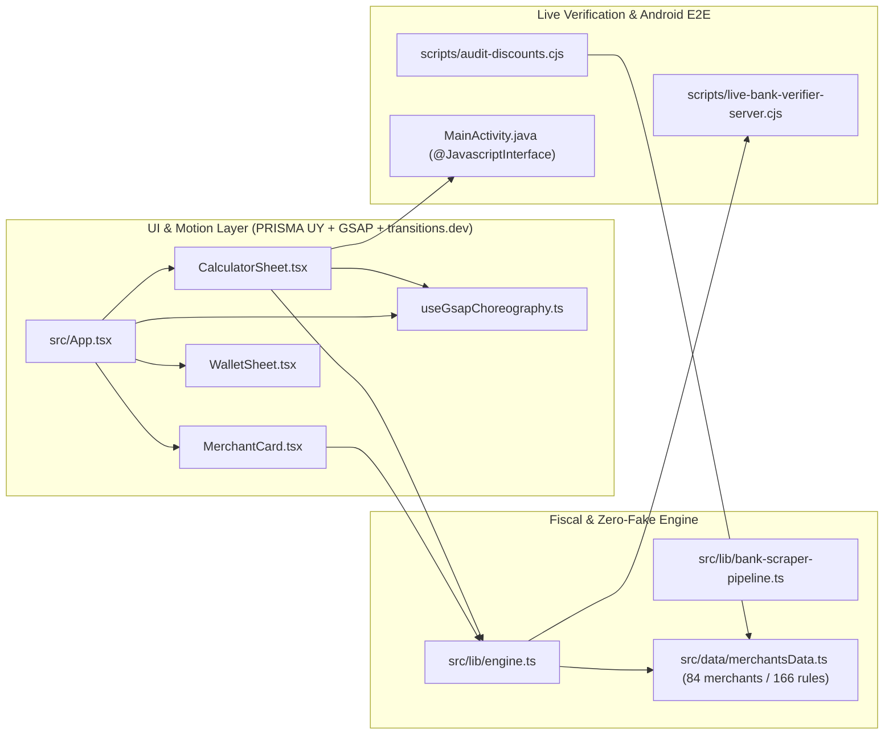

# Graphify Deterministic AST Knowledge Graph — ¿Con Cuál Pago? UY

> Generated deterministically via AST & structural analysis (`scripts/graphify-ast.cjs`). Zero LLM tokens used.

## Corpus Summary
- **Files Scanned:** `35`
- **Total Words:** `227,348`
- **Total Graph Nodes:** `454`
- **Total Directed Edges:** `921` (`EXTRACTED`: 753, `INFERRED`: 168)
- **Cross-Community Bridges:** `724`

## Top 10 God Nodes (Central Architectural Hubs)

| Rank | Node Label | Kind | Source File | In-Degree | Out-Degree | Total Degree |
| :--- | :--- | :--- | :--- | :---: | :---: | :---: |
| 1 | `merchantsData.ts` | `module` | `src/data/merchantsData.ts` | 5 | 288 | **293** |
| 2 | `live-bank-verifier-server.cjs` | `module` | `scripts/live-bank-verifier-server.cjs` | 0 | 285 | **285** |
| 3 | `engine.ts` | `module` | `src/lib/engine.ts` | 6 | 47 | **53** |
| 4 | `App.tsx` | `module` | `src/App.tsx` | 1 | 45 | **46** |
| 5 | `CalculatorSheet.tsx` | `module` | `src/components/CalculatorSheet.tsx` | 1 | 27 | **28** |
| 6 | `discount.ts` | `module` | `src/types/discount.ts` | 9 | 17 | **26** |
| 7 | `MerchantCard.tsx` | `module` | `src/components/MerchantCard.tsx` | 4 | 15 | **19** |
| 8 | `dates.ts` | `module` | `src/lib/dates.ts` | 4 | 11 | **15** |
| 9 | `live-catalog-sync.ts` | `module` | `src/lib/live-catalog-sync.ts` | 1 | 14 | **15** |
| 10 | `AffiliateSheet.tsx` | `module` | `src/components/AffiliateSheet.tsx` | 1 | 12 | **13** |

## Community Clusters

| Community ID | Node Count | Representative Nodes |
| :--- | :---: | :--- |
| `core-app` | 20 | `src/App.tsx`, `App`, `src/main.tsx`, `src/types/discount.ts` |
| `ui-components` | 19 | `src/components/AffiliateSheet.tsx`, `AffiliateSheet`, `src/components/CalculatorSheet.tsx`, `CalculatorSheet` |
| `verified-data` | 4 | `src/data/cards.ts`, `src/data/merchantsData.ts`, `DATA_LAST_UPDATED`, `DATA_VERIFIED_AT` |
| `hooks-motion` | 6 | `src/hooks/useGsapChoreography.ts`, `getGsap`, `useAnimatedUYU`, `useGsapCardFan` |
| `fiscal-bank-engine` | 73 | `src/lib/bank-scraper-pipeline.ts`, `VerifiedCardTier`, `VerifiedDiscountRecord`, `LiveProbeResponse` |
| `verification-pipeline` | 46 | `scripts/android-test-runner.cjs`, `sleep`, `scripts/audit-data-accuracy.cjs`, `loadMerchantsData` |
| `android-native` | 3 | `android-app/app/src/main/java/com/example/concualpagouy/MainActivity.java`, `MainActivity`, `AndroidBankVerifier` |
| `bank-catalogs` | 283 | `//www.itau.com.uy/inst/beneficios.html`, `//www.santander.com.uy/beneficios`, `//beneficios.brou.com.uy/`, `//www.scotiabank.com.uy/Personas/Tarjetas/Programas-de-premios/home-tarjetas` |

## Architectural Call & Verification Flow

